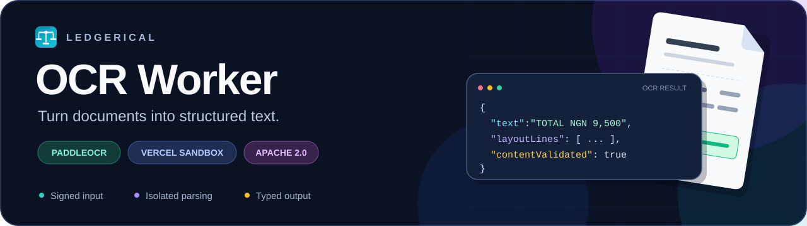
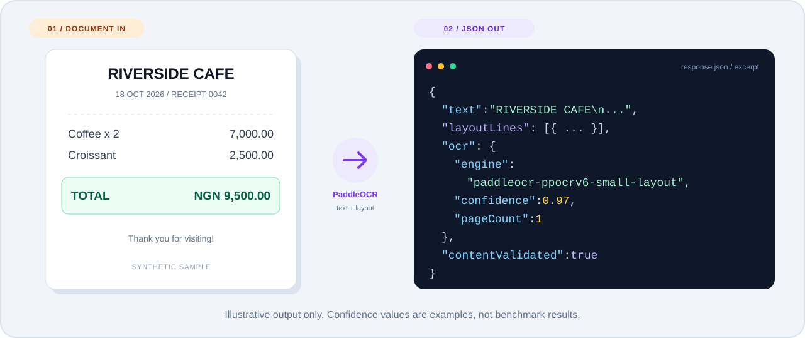
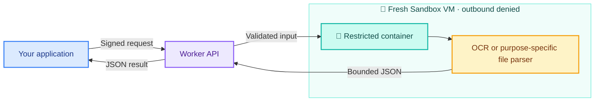

<a name="top"></a>

<h1 align="center">📄 Ledgerical OCR &amp; File Processing Worker</h1>

<p align="center">
  
</p>

<p align="center">
  <b>🧠 Read documents. 🔏 Verify requests. 🫧 Isolate every job.</b><br />
  OCR, file validation, table extraction and image processing with Vercel Functions and ephemeral Sandbox workers.
</p>

<p align="center">
  <a href="#requirements"></a>
  <a href="#requirements"></a>
  <a href="#features"></a>
  <a href="LICENSE"></a>
  <a href="#runtime-limits"></a>
</p>

<p align="center">
  <a href="#demo">🎬 See the demo</a> ·
  <a href="#quick-start">🚀 Get started</a> ·
  <a href="#api">🔌 Explore the API</a> ·
  <a href="#contributing">🤝 Contribute</a>
</p>

---

An open-source document-processing worker for developers who need OCR, table
extraction and image conversion behind a signed HTTP API. Deploy your own
instance, connect it to your application and receive bounded JSON results.

The worker supports two kinds of requests:

- **OCR:** PDF/image text, normalized layout lines, confidence scores, statement
  proposals and processing metadata.
- **File processing:** format validation, CSV/Excel records and canonical PNG
  images.

Use it for receipt tools, document review, import previews or other workflows
that need structured output from uploaded files. Contributions to extraction
quality, documentation and supported formats are welcome.

> [!IMPORTANT]
> 🧪 **Experimental project.** Validate OCR accuracy, cold-start timing and runtime
> isolation in your deployment before relying on it for production workloads.

<details>
<summary><b>🧭 Explore the guide</b></summary>

- [✨ Features](#features)
- [🎬 Demonstration](#demo)
- [🧩 How it works](#how-it-works)
- [🧰 Requirements](#requirements)
- [🚀 Quick start](#quick-start)
- [⚙️ Configuration](#configuration)
- [🔌 API](#api)
- [📏 Runtime limits](#runtime-limits)
- [🛡️ Security](#security)
- [🧯 Operations and troubleshooting](#operations-and-troubleshooting)
- [🛠️ Development](#development)
- [🤝 Contributing](#contributing)
- [🔗 Connect your application](#application-integration)
- [📜 License and acknowledgements](#license-and-acknowledgements)

</details>

### File processing beyond OCR

File processing uses **`POST /v1/files/process` with schema 3 grants**. Existing
OCR uses **`POST /v1/process` with schema 1 or 2 grants**. These endpoints have
different formats, input modes, result schemas and limits; a file that passes
validation is not necessarily eligible for OCR.

For file processing, prepare a snapshot from the current source. Configure
`FILE_PROCESSOR_SOURCE_ORIGIN` if you use signed source URLs. The [API](#api)
and [configuration](#configuration) sections describe both request types.

<a name="features"></a>

## ✨ Features

| | What you get |
| --- | --- |
| 🧠 **PaddleOCR on CPU** | PP-OCRv6 small detection and recognition models. |
| 📑 **OCR formats** | PDF, PNG, JPEG and WebP within explicit input and decoding limits. |
| 🔎 **Text + layout** | Native PDF text extraction, bounded OCR fallback, normalized lines and confidence metadata. |
| 🏦 **Statement proposals** | Bank-statement text proposals for review by the consuming application. |
| 📁 **File validation** | PDF, PNG, JPEG, WebP, CSV, DOCX and XLSX, with purpose-specific limits. |
| 📊 **Table extraction** | Bounded CSV records or the first XLSX worksheet; formulas are not evaluated. |
| 🖼️ **Canonical images** | Metadata-stripped PNG output for signature and public-image purposes. |
| 🔏 **Signed requests** | HMAC-SHA256 authorization bound to scope, size and the exact file's SHA-256. |
| 🫧 **Temporary processing** | Fresh job sandboxes with bounded RAM mounts for input, output and scratch. |
| 🔌 **Independent deployment** | No application database or long-lived storage credentials. The trusted gateway can fetch a signed private object from one configured storage origin. |

<a name="demo"></a>

## 🎬 From document to JSON

<p align="center">
  
</p>

<p align="center">
  <a href="docs/assets/sample-receipt.png">📥 Download the synthetic receipt</a> ·
  <a href="examples/process-document.mjs">🧑‍💻 View the signed-request example</a>
</p>

> [!NOTE]
> The artwork and response below are **illustrative examples**, not a recorded
> inference run or an accuracy benchmark. The fixture contains no customer data.

### 🧑‍💻 Run the signed-request demo

Complete [Quick start](#quick-start) first. After deploying the worker, add its
origin and existing grant secret to your private `.env.local`. Replace both
placeholders with your actual settings:

```dotenv
OCR_WORKER_URL=https://YOUR-WORKER-PROJECT.vercel.app
OCR_WORKER_GRANT_SECRET=<same-secret-configured-on-the-worker>
```

Then run the included example from the repository root:

```sh
node --env-file=.env.local examples/process-document.mjs docs/assets/sample-receipt.png
```

The example signs a fresh 60-second grant, sends the sample, validates the
returned bindings and prints the response JSON in your terminal. It generates
temporary request and scope UUIDs. In your own application, supply the UUID
that represents the request's authorized scope in `workspaceId`.

**This command runs a real OCR job and uses billable Vercel Sandbox resources.**
Run it from a trusted local or server environment, where the signing key can
remain private. Actual recognized text, line positions and confidence can vary.

<details>
<summary><b>📦 Expand an illustrative response excerpt</b></summary>

This excerpt shows the shape of OCR content. The full response also includes
request/workspace IDs, source digest/size/type and processing metrics.

```json
{
  "schemaVersion": 2,
  "text": "RIVERSIDE CAFE\n18 October 2026\nTOTAL NGN 9,500.00",
  "layoutLines": [
    {
      "text": "TOTAL NGN 9,500.00",
      "page": 1,
      "x0": 0.10,
      "y0": 0.56,
      "x1": 0.90,
      "y1": 0.65,
      "confidence": 0.97
    }
  ],
  "ocr": {
    "engine": "paddleocr-ppocrv6-small-layout",
    "confidence": 0.97,
    "pageCount": 1,
    "imagePixels": 432000,
    "lineCount": 1
  },
  "contentValidated": true
}
```

</details>

<a name="how-it-works"></a>

## 🧩 How it works



Your server signs a short-lived request containing the file's scope, size and
SHA-256. The worker verifies the request, processes the authorized bytes in a
temporary sandbox and returns JSON. The sandbox is deleted after the job.

Code and model assets are prepared ahead of time. OCR requests use PaddleOCR
when needed; file validation, table extraction and image conversion use their
own parsers. See [Security](#security) for the worker's isolation controls and
their limitations.

<a name="requirements"></a>

## 🧰 Requirements

| Component | Requirement |
| --- | --- |
| Setup and gateway | Node.js 24.x and npm |
| Hosting | A Vercel project with Fluid Compute and Sandbox access |
| Parsing runtime | Linux, Python 3.12 and Docker; provisioned by the preparation script inside Sandbox |
| Python development | A separate Python 3.12 environment; Linux for runtime isolation work |

Local Docker and Python installations are not required for the Vercel setup
commands. Snapshot preparation and document processing use billable Vercel
resources. Configure spending controls for the project.

<a name="quick-start"></a>

## 🚀 Quick start

Fork or clone this repository, then run the following commands from the
directory containing `package.json` and `vercel.json`.

### 1️⃣ Create the Vercel project

Import the repository into a dedicated Vercel project with these settings:

| Setting | Value |
| --- | --- |
| Framework Preset | Other |
| Root Directory | **Leave empty** when this repository is the project root. For a larger repository, select the directory containing this worker's `package.json` and `vercel.json`. |
| Node.js version | 24.x |
| Install command | `npm ci` |
| Build command | `npm run build` |
| Output Directory | `public` (configured by `vercel.json`) |
| Fluid Compute | Enabled |

The HTTP entry points are in `api/`. The Dockerfile at
[`sandbox/Dockerfile`](sandbox/Dockerfile) builds the parser container inside
the sandbox during model preparation.

> [!IMPORTANT]
> **Do not set Root Directory to `sandbox`.** Deploy the folder containing
> `package.json`, `vercel.json` and `api/`. Selecting `sandbox` makes Vercel
> look for build output and API functions in the parser's source folder.
> If you already selected it, open **Settings → Build and Deployment → Root
> Directory**, clear the field, save and redeploy.

### 2️⃣ Install dependencies and authenticate

```sh
npm ci
npx vercel login
npx vercel link
npx vercel env pull .env.local
```

Select the worker project when linking. The environment pull creates
`.env.local` with a local `VERCEL_OIDC_TOKEN`. The setup scripts load this file
and check for authentication before creating cloud resources.

Use [Configuration](#configuration) as a reference for worker settings. Pull
Vercel authentication with the command above; creating an empty `.env.local`
does not authenticate the script. Keep the generated file out of version control.

In deployed Functions, Vercel manages OIDC authentication. For external CI,
the scripts also accept `VERCEL_TOKEN`, `VERCEL_TEAM_ID` and
`VERCEL_PROJECT_ID` together. See [Vercel authentication documentation](https://vercel.com/docs/sandbox/concepts/authentication).

### 3️⃣ Prepare the code and model snapshot

```sh
npm run prepare:snapshot
```

Preparation installs Docker in an empty sandbox, builds the pinned Python
image and downloads the OCR models. It then denies outbound traffic, checks
the runtime restrictions and saves a snapshot containing code and models.
The preparation VM is deleted afterward.

Preparation checks cgroup prerequisites before installing Docker. At job
startup, the bootstrap enables CPU, memory and process controllers before
accepting file bytes. Where a delegated domain requires it, supervisor
processes move to a separate leaf; controller setup retries for up to two
seconds because the process list can change. Unsupported cgroup layouts fail
closed. Both controller setup and the restricted container probe must succeed.

On success, the command prints values in this form:

```dotenv
OCR_SANDBOX_SNAPSHOT_ID=snap_example
OCR_SANDBOX_REGION=iad1
```

**Use the actual values printed by your command.** `snap_example` above is
illustrative. The snapshot ID is generated by Vercel; it is not a value to
invent or obtain from PaddleOCR.

### 4️⃣ Configure and deploy

Add the variables in [Configuration](#configuration) to the Vercel project's
Production environment, then deploy:

```sh
npx vercel --prod
```

Use the resulting stable HTTPS origin for application requests. Both processing
endpoints must accept authenticated server-to-server calls without an
interactive Vercel login screen. Every processing request still requires a
valid signed grant.

### 5️⃣ Connect your application

Use `POST /v1/process` for OCR or `POST /v1/files/process` for validation,
table extraction and image processing, following the [API contract](#api).
Keep the signing key in trusted server environments. The calling application
handles user authorization, usage quotas and review of the extracted content.

See [Connect your application](#application-integration) for a short integration
checklist.

<a name="configuration"></a>

## ⚙️ Configuration

Set worker runtime values in the Vercel project's environment settings and
redeploy after changing them.

| Variable | Required | Value |
| --- | --- | --- |
| `OCR_WORKER_GRANT_SECRET` | 🟢 Yes | A random secret of at least 32 UTF-8 bytes, shared with the trusted grant issuer. |
| `OCR_SANDBOX_SNAPSHOT_ID` | 🟢 Yes | The `snap_...` ID printed by `npm run prepare:snapshot`. |
| `FILE_PROCESSOR_SOURCE_ORIGIN` | For signed object reads | Exact HTTPS origin allowed for file-source requests, such as `https://storage.example.com`. No bucket, path, query, fragment or embedded credentials. Inline requests do not require this setting. |
| `OCR_SANDBOX_REGION` | ⚪ No | Snapshot and job region; defaults to `iad1`. Use the same region during preparation and processing. |
| `OCR_SANDBOX_SLOT` | ⚪ No | Fixed sandbox slot name shared by OCR and file-processing jobs; defaults to `ledgerical-ocr-active`. Keep one slot per project to limit concurrent jobs. |

For a new installation, a 32-byte random secret can be generated locally:

```sh
node -e "console.log(require('node:crypto').randomBytes(32).toString('hex'))"
```

Configure the same value on the worker and on your server-side request signer.
Keep the secret out of source control, browser bundles, model snapshots and
parser environment variables.

The included demo reads `OCR_WORKER_URL` to find your deployed worker. Vercel
authentication is separate from the file grant secret; use the credentials
described in Quick start in the trusted gateway or setup environment.

<a name="api"></a>

## 🔌 API

| Endpoint | Grant header | Schema | Purpose |
| --- | --- | --- | --- |
| `GET /healthz` | None | — | Configuration diagnostics; no processing. |
| `POST /v1/process` | `X-Ledgerical-OCR-Job-Grant` | 1 or 2 | Immutable-document OCR or transient receipt OCR. |
| `POST /v1/files/process` | `X-Ledgerical-File-Grant` | 3 | File validation, tabular records or canonical images. |

### 🩺 Health

`GET /healthz` checks whether the worker configuration is present. It does not
allocate a sandbox or run inference. A configured response looks like:

```json
{
  "status": "configured",
  "worker": "vercel-sandbox-ocr-v1",
  "inferenceVerified": false,
  "fileProcessing": {
    "protocolVersion": 3,
    "sourceOriginConfigured": true,
    "inferenceVerified": false
  }
}
```

`sourceOriginConfigured` reports the storage-origin setting separately. The
endpoint can return HTTP 200 with that value `false`; this does not establish
readiness for storage-backed file processing. Health does not check snapshot
existence, live credentials, parser restrictions, storage access or OCR accuracy.

### 📤 OCR a document

`POST /v1/process` accepts the raw file bytes with these headers:

| Header | Value |
| --- | --- |
| `Content-Type` | `application/octet-stream` |
| `Content-Length` | Exact byte length, matching the signed grant |
| `X-Ledgerical-OCR-Job-Grant` | Signed capability for this request |

The grant is a base64url-encoded JSON payload followed by a dot and a
base64url-encoded HMAC-SHA256 signature. Base64url segments have no padding;
the signature covers the encoded payload string.

```text
payload = base64url(UTF8(JSON(claims)))
signature = base64url(HMAC_SHA256(secret, payload))
grant = payload + "." + signature
```

OCR grants include:

| Claim | Meaning |
| --- | --- |
| `schemaVersion` | `1` for an immutable document; `2` for a transient receipt preview |
| `audience` | Exactly `document-ocr-worker` |
| `workspaceId` | Application-defined scope UUID. |
| `filename` | File basename, up to 255 characters, with an allowed extension |
| `contentType` | MIME type matching the filename extension |
| `sizeBytes` | Exact input byte length |
| `sha256` | SHA-256 digest of the exact input bytes |
| `issuedAt`, `expiresAt` | Unix timestamps in seconds; grant lifetime at most 120 seconds |

**Use schema 2 for the standalone receipt-preview example.** It requires
`requestId` and `purpose: "receipt-preview"` alongside the fields above.
UUID fields must contain valid UUIDs. Unknown claims are rejected.

Schema 1 is also available for version-bound document jobs. Its additional
fields and validation rules are defined in [`lib/protocol.mjs`](lib/protocol.mjs) and
[`sandbox/ocr_worker/grant.py`](sandbox/ocr_worker/grant.py).

Successful responses contain extracted text, normalized `layoutLines`,
`bankStatement` proposals, OCR metadata, processing metrics and the request's
scope/hash/size bindings. Full response models are defined in
[`sandbox/ocr_worker/app.py`](sandbox/ocr_worker/app.py).
Consumers should validate those bindings and treat extracted content as
untrusted input.

Both APIs use error envelopes such as:

```json
{"detail":{"error":"INVALID_OCR_JOB_GRANT"}}
```

### 📁 Process a file

`POST /v1/files/process` uses a separate `X-Ledgerical-File-Grant` header and
the same base64url/HMAC signing algorithm described above. Its signed claims
are **exactly**:

| Claim | Value |
| --- | --- |
| `schemaVersion` | `3` |
| `audience` | `document-file-worker` |
| `workspaceId`, `requestId` | Valid application-scope and request UUIDs. |
| `purpose` | `validate`, `tabular`, `signature-image` or `public-image`. |
| `filename`, `contentType` | A basename up to 255 characters, with a matching allowed extension/MIME type. |
| `sizeBytes`, `sha256` | Exact source size and lowercase 64-character SHA-256 hex digest. |
| `sourceUrl` | Empty string for inline bytes, or a short-lived signed HTTPS object URL. This field is always present. |
| `issuedAt`, `expiresAt` | Unix seconds, no more than 120 seconds apart. Issue time may be at most 30 seconds ahead or 120 seconds behind the gateway clock. |

Unknown or missing claims are rejected. Do not send an OCR grant to this API.

#### Input modes

| Mode | Request body and headers |
| --- | --- |
| Inline, at most 2 MiB | `sourceUrl: ""`; raw bytes with `Content-Type: application/octet-stream` and exact `Content-Length: sizeBytes`. No compressed request body. |
| Signed object read | Nonempty `sourceUrl`; empty request body with `Content-Length: 0`. The trusted gateway fetches the source, checks its declared/actual size and digest, and refuses redirects or compressed responses. |

Send the length headers shown above when available. If a proxy omits a length
header, the worker still enforces the exact signed size while streaming and
checks the SHA-256 before processing. A conflicting declared length is rejected.

Signed sources must match `FILE_PROCESSOR_SOURCE_ORIGIN` and the scope-path
checks in [`lib/file-processing.mjs`](lib/file-processing.mjs). Your server
selects the authorized source and signs the request. The signed URL is removed
before the job enters the parser VM. Use this mode for inputs over 2 MiB; it
does not increase the purpose-specific file limits.

#### Purposes and results

| Purpose | Accepted inputs | Result |
| --- | --- | --- |
| `validate` | PDF, PNG, JPEG, WebP, CSV, DOCX, XLSX | Bounded format checks; empty `records` and `imageBase64`. No OCR or document text extraction. |
| `tabular` | CSV, XLSX | `records` as arrays of strings; the first XLSX worksheet only. No formula evaluation; saved formula values may be returned. |
| `signature-image` | PNG, JPEG, WebP | `imageBase64` containing a canonical PNG; rejects empty signatures and oversized images. |
| `public-image` | PNG, JPEG, WebP | `imageBase64` containing a canonical PNG, resized to fit within 1024 × 1024 pixels. |

Every successful schema 3 response includes `schemaVersion`, `workspaceId`,
`requestId`, `purpose`, `sourceSha256`, `sourceSizeBytes`, `detectedContentType`,
`contentValidated`, `records` and `imageBase64`. Consumers must verify the
bindings before accepting the records or image. The image is a derivative;
the response does not make the private original public.

Office archives are processed within expansion/XML limits. Macros are rejected,
external resources are not fetched, and formulas are not executed. Format
validation is not a malware scan or a guarantee that an original is safe to open.

The canonical contract and checks are in
[`lib/file-processing.mjs`](lib/file-processing.mjs),
[`sandbox/ocr_worker/file_processor.py`](sandbox/ocr_worker/file_processor.py)
and [`sandbox/ocr_worker/vercel_runner.py`](sandbox/ocr_worker/vercel_runner.py).

<a name="runtime-limits"></a>

## 📏 Runtime limits

### OCR (`/v1/process`)

| Resource | Limit |
| --- | --- |
| Input size | 2 MiB |
| Formats | PDF, PNG, JPEG, WebP |
| PDF pages | Exactly one |
| Image pixels | At most 4 million |
| OCR child deadline | 25 seconds |
| Gateway processing budget | 28 seconds, followed by up to 7 seconds of cleanup |
| Output | At most 1 MiB, 200,000 text characters and 500 layout lines |

### File processing (`/v1/files/process`)

| Resource | Limit |
| --- | --- |
| Inline input size | 2 MiB for every format |
| Signed-source input size | 10 MiB for PDF/DOCX/XLSX; 5 MiB for images/CSV |
| PDF validation | 1–100 pages; encrypted PDFs rejected. This does not enable multi-page OCR. |
| Images | One frame; 4 million pixels for signatures, 16 million for other file-image purposes |
| Signature dimensions | At most 4096 pixels per side |
| Canonical PNG output | At most 1 MiB decoded; public images fit within 1024 × 1024 pixels |
| Tabular output | At most 10,001 records, 200 columns, 64 KiB per UTF-8 cell and 2 MiB total cell data |
| CSV validation without extraction | At most 100,000 rows and 1,000 columns, with bounded cells |
| Office archives | At most 2,000 entries, 8 MiB per member and 64 MiB total actual expanded data; excessive compression ratios rejected |
| Gateway processing budget | 20 seconds, followed by up to 7 seconds of cleanup |
| Output JSON | At most 3 MiB; escaping and envelope overhead can reach this before the cell-data limit |

### Shared isolation limits

| Resource | Limit |
| --- | --- |
| Concurrent jobs | One named sandbox slot shared by both APIs per project; slot conflicts receive HTTP 429 |
| Parser container | One CPU, 1 GiB RAM, 128 processes |
| Parser scratch | 64 MiB RAM-only `/tmp` |
| VM input/output mount | 16 MiB RAM-only storage |
| Container command deadline | 28 seconds, also bounded by the gateway deadline |
| Job VM lifetime | 45 seconds |

`vercel.json` permits 60 seconds for each processing Function and 10 seconds
for health. The shorter application deadlines above still apply. A larger
Function duration does not increase the file, parser or output limits.

A health response does not establish that inference fits these budgets. Measure
model startup, OCR quality, memory use and cleanup behavior on the target host.

<a name="security"></a>

## 🛡️ Security

- Each job restores trusted code/models into a fresh, nonpersistent VM with no
  exposed ports and denied outbound traffic from creation. Job code does not
  attach storage drives or snapshot customer input/output.
- The parser container runs as a non-root user with a read-only root filesystem,
  no capabilities, no new privileges, no network, no swap and bounded cgroups.
- Runtime guards check the required restrictions before accepting document bytes.
  The parser child installs an additional syscall filter before loading parsers.
- The syscall filter denies network connections, program execution, descendant
  processes, process inspection/signalling and namespace changes.
- Signing keys, Vercel tokens and application credentials remain outside the
  parser VM. The container needs no database or object-storage access.
- Only the trusted gateway can fetch the signed source, from the configured
  storage origin. It strips the URL before sending the job to the parser VM.
- Input, output and temporary parser files stay in bounded RAM mounts. Model
  weights are read-only; writable caches and locks use temporary scratch space.
- Document bytes and extracted text are not printed to application, Sandbox
  command or Docker logs. Results are retrieved through a bounded file read.
- Cleanup stops and deletes the job VM after success or failure. The VM also
  has a hard expiration in case the coordinating Function is interrupted.

Cleanup uses one Sandbox delete request with an independent seven-second
deadline. Vercel's [delete operation](https://github.com/vercel/sdk/blob/main/docs/sdks/sandboxes/README.md#deletesandbox)
stops running sessions before deleting the sandbox. A confirmed deletion (or
HTTP 404 for an already deleted sandbox) completes cleanup. An unconfirmed
deletion still fails the request and logs `OCR_SANDBOX_DELETE_FAILED` with
only a safe error type and HTTP status. OCR budgets 28 seconds for processing
plus 7 seconds for cleanup; file processing uses 20 plus 7 seconds. Allow for
network overhead when setting your client's timeout. These are request budgets,
not latency guarantees.

The worker provides containment controls; it does not scan for malware.
Parser and kernel vulnerabilities remain possible. Preserve the runtime guards
and validate their enforcement when changing deployment settings or dependencies.

Keep credentials, real customer documents and sensitive diagnostics out of
public issues and pull requests. Report vulnerabilities privately through
GitHub's **Report a vulnerability** option when enabled, or request a private
contact from a maintainer without posting the sensitive details.

<a name="operations-and-troubleshooting"></a>

## 🧯 Operations and troubleshooting

<details>
<summary><b>🔑 Refresh authentication</b></summary>

Run this from the repository root when the local OIDC token expires:

```sh
npx vercel env pull .env.local
```

</details>

<details>
<summary><b>📦 Rebuild models or parser code</b></summary>

Run `npm run prepare:snapshot` after changing Python code, model assets,
container dependencies or sandbox shell scripts. Set the newly printed
snapshot ID on Vercel and redeploy the gateway.

Preparation now checks a generated JPEG through the offline image-recognition
path with the same CPU, memory, filesystem and parser restrictions as a real
job. A snapshot is not published if model startup or inference fails. This is
a readiness check, not an OCR accuracy benchmark, and uses no customer data.
Runtime models use explicit local directories, one inference thread and bounded
batches; requests do not download model files.

Redeploying the gateway without preparing and selecting a new snapshot does not
update the Python processor or its models. A text-based PDF can succeed without
image recognition, so PDF success alone does not establish JPEG readiness.

Code/model snapshots have automatic expiration disabled. Delete superseded
snapshots in Vercel once deployments no longer use them.

</details>

<details>
<summary><b>🧹 Recover a stale slot</b></summary>

Pause new processing requests, wait for the 45-second VM deadline, then run:

```sh
npm run cleanup:slot
```

Use the same `OCR_SANDBOX_SLOT` locally if you changed its default. The command
only deletes stopped or failed slots and never resumes or snapshots a job.

</details>

| Symptom | Action |
| --- | --- |
| `OCR_DEPLOYMENT_ROOT_INVALID`, missing `public` output, or Paddle installing during the gateway build | Clear `sandbox` from Vercel's Root Directory. Leave it empty for the standalone repository, save and redeploy. The gateway uses Node.js; Python dependencies are installed when preparing the sandbox snapshot. |
| `/healthz` returns `OCR_WORKER_NOT_CONFIGURED` | Its `detail.missingOrInvalid` array lists variable names to fix. Configure the shared signing secret and a snapshot ID printed by successful `npm run prepare:snapshot` in the deployment's environment, then redeploy. A local `.env` file does not configure Vercel. |
| Missing `.env.local` or authentication | Run `npx vercel login`, `npx vercel link` and `npx vercel env pull .env.local` from the repository root. |
| Preparation fails while creating upload directories, uploading source or verifying it | Use the current preparation script and rerun `npm run prepare:snapshot`. It creates parent directories recursively and verifies uploaded hashes and executable scripts. The error includes the precise stage and safe HTTP/filesystem codes; share those diagnostics when reporting a failure. |
| `OCR_WORKER_NOT_CONFIGURED` | Check the worker secret, snapshot ID, region and slot settings, then redeploy. |
| `INVALID_OCR_JOB_GRANT` | Check the issuer/worker secrets, signed fields, exact file bytes and clocks. |
| `INVALID_FILE_JOB_GRANT` | Check the schema 3 audience, purpose, exact claims, size/format limits and clocks. For signed reads, also check the allowlisted origin and workspace path. |
| `FILE_SOURCE_ORIGIN_NOT_CONFIGURED` or health shows `sourceOriginConfigured: false` | Set `FILE_PROCESSOR_SOURCE_ORIGIN` to the exact HTTPS source origin on the worker and redeploy. Health can be HTTP 200 while this setting is missing. |
| `FILE_REQUEST_BODY_INVALID` | Inline mode requires octet-stream bytes and the exact length; signed-source mode requires an empty body and `Content-Length: 0`. |
| `FILE_SOURCE_MISMATCH` or `SOURCE_HASH_MISMATCH` | Check the signed object's size/digest, URL expiry and storage response. Redirects and compressed object responses are refused. |
| `INVALID_DOCUMENT_FORMAT` or `UNSUPPORTED_DOCUMENT_FORMAT` | Check the selected endpoint, purpose, extension/MIME pair, pages, image dimensions and archive/table limits. Validation success does not make a larger file eligible for OCR. |
| `FILE_WORKER_RESULT_MISMATCH` or `OCR_WORKER_RESULT_MISMATCH` | Check that the deployed gateway and prepared snapshot use matching source/contracts. Do not bypass binding checks. |
| `OCR_SANDBOX_UNAVAILABLE` | Inspect the accompanying `OCR_SANDBOX_BOOT_FAILED` stage and exit code. Cgroup setup retries changes in the live process list; persistent failures still block receipt transfer. After changing `sandbox/boot.sh`, prepare a new trusted snapshot, update the Production snapshot ID and redeploy. Keep the runtime guards enabled. |
| `OCR_WORKER_TIMEOUT` | Measure snapshot restore and model startup against the request budgets. |
| `OCR_MODEL_UNAVAILABLE` | Inspect the accompanying `OCR_PARSER_FAILED` diagnostic. Prepare a new snapshot, confirm offline image-recognition readiness passes, select its snapshot ID and redeploy. Keep runtime isolation enabled. |
| `OCR_PARSER_FAILED` or `OCR_PARSER_EXIT` | Logs contain only a fixed stage, allowlisted error type, bounded exit code and request/job correlation ID. Share these facts when reporting failures, without document contents. A child exit code can identify a native crash or resource termination; it does not by itself establish the cause. |
| `OCR_WORKER_BUSY` | OCR and file-processing jobs share the same slot. Respect the response's `Retry-After` header before retrying, or recover an expired stale slot. |
| `OCR_SANDBOX_CLEANUP_INCOMPLETE` | Wait for VM expiration, then remove the stopped slot. |
| Application receives HTTP 503 | Check the worker URL, project authentication, snapshot availability and server-to-server access. |

<a name="development"></a>

## 🛠️ Development

```text
api/                             Health, OCR and schema 3 file-processing HTTP entry points
docs/assets/                     README illustrations and synthetic receipt
examples/                        Signed-request demo for trusted Node.js clients
lib/                             OCR/file grant validation, source reads and sandbox orchestration
sandbox/ocr_worker/               OCR, file/table/image parsers, isolation and result models
sandbox/Dockerfile                Pinned Python runtime and model preparation
sandbox/*.sh                      Sandbox/container lifecycle scripts
scripts/                         Preparation, recovery and static build commands
site/                            Source for the generated public landing page
tests/                           Python tests and gateway deployment regression checks
vendor-manifest.json              Core source and dependency SHA-256 hashes
```

Use the static build command when changing JavaScript or configuration:

```sh
npm ci
npm run build
```

The build checks JavaScript syntax, configuration JSON and the source hashes
listed in `vendor-manifest.json`. Review and update affected hashes when
changing those core files. It also validates the Vercel invocation directory
and generates `public/index.html`. The build does not create cloud resources
or run OCR inference or Python tests.

Run the deployment regression checks with `npm run test:deployment`. They use
temporary local fixtures to check a clean build, repeated builds and the
incorrect `sandbox` Root Directory setting; no cloud credentials are needed.
Run `npm run test:worker` to check safe health diagnostics and required worker
configuration. These checks do not create sandboxes or run inference.
Run `npm run test:snapshot` for source-upload preparation checks, including
missing parent directories, source integrity and safe error reporting. These
also run locally without Vercel credentials or cloud resources.

For the Python suite, use a separate Linux/Python 3.12 environment:

```sh
python3.12 -m venv .venv
. .venv/bin/activate
python -m pip install -r requirements-test.txt
python -m pytest
```

`pytest.ini` resolves worker imports from `sandbox/`. Keep untrusted or
malicious document samples inside the isolated parser runtime. Mock-based
checks do not establish that deployment isolation is enforced.

<a name="contributing"></a>

## 🤝 Contributing

Contributions to documentation, format handling, extraction quality and runtime
isolation are welcome.

1. Fork the repository and create a focused branch.
2. Describe the problem and proposed behavior in an issue or pull request.
3. Preserve grant verification, input/output bounds and sandbox restrictions.
4. Explain validation performed and any remaining runtime limitations.
5. Use synthetic or properly anonymized fixtures and omit credentials and
   customer data from patches, logs and screenshots.

For dependency or model changes, update the Linux/Python 3.12 lockfile, review
upstream security/license implications and prepare a new model snapshot.

<a name="application-integration"></a>

## 🔗 Connect your application

1. Deploy your worker and keep its HTTPS base URL in your server configuration.
2. Configure the same `OCR_WORKER_GRANT_SECRET` on the worker and your
   server-side request signer.
3. Choose the endpoint and schema for your task. The included
   [Node.js example](examples/process-document.mjs) demonstrates schema 2 OCR.
4. Authorize the file in your application, calculate its size and SHA-256, and
   create a short-lived grant with the required scope and purpose.
5. Send the bytes, or use a schema 3 signed source URL when needed. Keep signing
   credentials on your server.
6. Check the HTTP status, result schema, scope, source digest and size before
   using the returned text, records or image.

Your application chooses how to review, display and save results. The worker
returns processing output and does not require your application's database.
Use synthetic inputs to evaluate accuracy and handling of invalid files before
connecting your own document workflows.

<a name="license-and-acknowledgements"></a>

## 📜 License and acknowledgements

This project is licensed under the [Apache License 2.0](LICENSE).
Third-party libraries and model assets retain their respective licenses.

Built with [PaddleOCR](https://github.com/PaddlePaddle/PaddleOCR),
[PaddlePaddle](https://github.com/PaddlePaddle/Paddle),
[pypdf](https://github.com/py-pdf/pypdf),
[pypdfium2](https://github.com/pypdfium2-team/pypdfium2) and
[Vercel Sandbox](https://vercel.com/docs/sandbox).

The npm package is marked `private` to prevent accidental npm publication.
This setting does not determine the GitHub repository's visibility.

---

<p align="center">
  <b>Built with open-source tools. Contributions welcome. 💙</b><br />
  <a href="#top">⬆️ Back to top</a>
</p>
