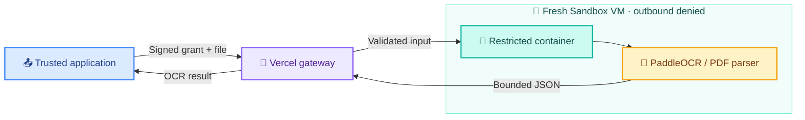

<a name="top"></a>

<h1 align="center">📄 Ledgerical OCR Worker</h1>

<p align="center">
  
</p>

<p align="center">
  <b>🧠 Read documents. 🔏 Verify requests. 🫧 Isolate every job.</b><br />
  PaddleOCR extraction with Vercel Functions and ephemeral Sandbox workers.
</p>

<p align="center">
  <a href="#requirements"></a>
  <a href="#requirements"></a>
  <a href="#features"></a>
  <a href="LICENSE"></a>
  <a href="#runtime-limits"></a>
</p>

<p align="center">
  <a href="#demo">🎬 See the demo</a> ·
  <a href="#quick-start">🚀 Get started</a> ·
  <a href="#api">🔌 Explore the API</a> ·
  <a href="#contributing">🤝 Contribute</a>
</p>

---

The worker turns signed PDF and image requests into **text, normalized layout
lines, confidence scores and processing metadata**. Python parsers run in a
fresh sandbox for each job. Applications use the returned JSON for their own
extraction, review and storage workflows.

> [!IMPORTANT]
> 🧪 **Experimental project.** Validate OCR accuracy, cold-start timing and runtime
> isolation in your deployment before relying on it for production workloads.

<details>
<summary><b>🧭 Explore the guide</b></summary>

- [✨ Features](#features)
- [🎬 Demonstration](#demo)
- [🧩 Architecture](#architecture)
- [🧰 Requirements](#requirements)
- [🚀 Quick start](#quick-start)
- [⚙️ Configuration](#configuration)
- [🔌 API](#api)
- [📏 Runtime limits](#runtime-limits)
- [🛡️ Security](#security)
- [🧯 Operations and troubleshooting](#operations-and-troubleshooting)
- [🛠️ Development](#development)
- [🤝 Contributing](#contributing)
- [🔗 Ledgerical integration](#ledgerical-integration)
- [📜 License and acknowledgements](#license-and-acknowledgements)

</details>

<a name="features"></a>

## ✨ Features

| | What you get |
| --- | --- |
| 🧠 **PaddleOCR on CPU** | PP-OCRv6 small detection and recognition models. |
| 📑 **Document formats** | PDF, PNG, JPEG and WebP within explicit input and decoding limits. |
| 🔎 **Text + layout** | Native PDF text extraction, bounded OCR fallback, normalized lines and confidence metadata. |
| 🏦 **Statement proposals** | Bank-statement text proposals for review by the consuming application. |
| 🔏 **Signed requests** | HMAC-SHA256 authorization bound to scope, size and the exact file's SHA-256. |
| 🫧 **Temporary processing** | Fresh job sandboxes with bounded RAM mounts for input, output and scratch. |
| 🔌 **Independent deployment** | A standalone worker with no application database or object-storage dependency. |

<a name="demo"></a>

## 🎬 From document to JSON

<p align="center">
  
</p>

<p align="center">
  <a href="docs/assets/sample-receipt.png">📥 Download the synthetic receipt</a> ·
  <a href="examples/process-document.mjs">🧑‍💻 View the signed-request example</a>
</p>

> [!NOTE]
> The artwork and response below are **illustrative examples**, not a recorded
> inference run or an accuracy benchmark. The fixture contains no customer data.

### 🧑‍💻 Run the signed-request demo

Complete [Quick start](#quick-start) first. After deploying the worker, add its
origin and existing grant secret to your private `.env.local`. Replace both
placeholders with your actual settings:

```dotenv
OCR_WORKER_URL=https://YOUR-WORKER-PROJECT.vercel.app
OCR_WORKER_GRANT_SECRET=<same-secret-configured-on-the-worker>
```

Then run the included example from the repository root:

```sh
node --env-file=.env.local examples/process-document.mjs docs/assets/sample-receipt.png
```

The example signs a fresh 60-second grant, sends the sample, validates the
returned bindings and prints the response JSON in your terminal. It generates
temporary request/workspace UUIDs; production applications should supply the
authenticated workspace's UUID.

**This command runs a real OCR job and uses billable Vercel Sandbox resources.**
Run it from a trusted local or server environment, where the signing key can
remain private. Actual recognized text, line positions and confidence can vary.

<details>
<summary><b>📦 Expand an illustrative response excerpt</b></summary>

This excerpt shows the shape of OCR content. The full response also includes
request/workspace IDs, source digest/size/type and processing metrics.

```json
{
  "schemaVersion": 2,
  "text": "RIVERSIDE CAFE\n18 October 2026\nTOTAL NGN 9,500.00",
  "layoutLines": [
    {
      "text": "TOTAL NGN 9,500.00",
      "page": 1,
      "x0": 0.10,
      "y0": 0.56,
      "x1": 0.90,
      "y1": 0.65,
      "confidence": 0.97
    }
  ],
  "ocr": {
    "engine": "paddleocr-ppocrv6-small-layout",
    "confidence": 0.97,
    "pageCount": 1,
    "imagePixels": 432000,
    "lineCount": 1
  },
  "contentValidated": true
}
```

</details>

<a name="architecture"></a>

## 🧩 Architecture



The trusted application issues a short-lived grant. The gateway verifies its
signature, scope, size and SHA-256 before allocating a sandbox. The parser
container loads models from a prepared snapshot and processes the document
with outbound network access disabled. The gateway then stops and deletes
the job sandbox.

The persistent snapshot contains trusted code and model assets. Job sandboxes
have persistence disabled; input, output and scratch files use bounded RAM
mounts. The grant signing key and Vercel credentials stay outside the parser VM.

<a name="requirements"></a>

## 🧰 Requirements

| Component | Requirement |
| --- | --- |
| Setup and gateway | Node.js 24.x and npm |
| Hosting | A Vercel project with Fluid Compute and Sandbox access |
| Parsing runtime | Linux, Python 3.12 and Docker; provisioned by the preparation script inside Sandbox |
| Python development | A separate Python 3.12 environment; Linux for runtime isolation work |

Local Docker and Python installations are not required for the Vercel setup
commands. Snapshot preparation and document processing use billable Vercel
resources. Configure spending controls for the project.

<a name="quick-start"></a>

## 🚀 Quick start

Fork or clone this repository, then run commands from its root. When working
inside the Ledgerical monorepo, this directory is `ocr/`.

### 1️⃣ Create the Vercel project

Import the repository into a dedicated Vercel project with these settings:

| Setting | Value |
| --- | --- |
| Framework Preset | Other |
| Root Directory | **Leave empty** for the standalone OCR repository; `ocr` only when importing the Ledgerical monorepo |
| Node.js version | 24.x |
| Install command | `npm ci` |
| Build command | `npm run build` |
| Output Directory | `public` (configured by `vercel.json`) |
| Fluid Compute | Enabled |

The HTTP entry points are in `api/`. The Dockerfile at
[`sandbox/Dockerfile`](sandbox/Dockerfile) builds the parser container inside
the sandbox during model preparation.

> [!IMPORTANT]
> **Do not set Root Directory to `sandbox`.** Deploy the folder containing
> `package.json`, `vercel.json` and `api/`. Selecting `sandbox` makes Vercel
> look for build output and API functions in the parser's source folder.
> If you already selected it, open **Settings → Build and Deployment → Root
> Directory**, clear the field, save and redeploy.

### 2️⃣ Install dependencies and authenticate

```sh
npm ci
npx vercel login
npx vercel link
npx vercel env pull .env.local
```

Select the worker project when linking. The environment pull creates
`.env.local` with a local `VERCEL_OIDC_TOKEN`. The setup scripts load this file
and check for authentication before creating cloud resources.

Use [`.env.example`](.env.example) as a reference for worker settings. Pull
Vercel authentication with the command above; copying the example file or
creating an empty `.env.local` does not authenticate the script. Keep the
generated file out of version control.

In deployed Functions, Vercel manages OIDC authentication. For external CI,
the scripts also accept `VERCEL_TOKEN`, `VERCEL_TEAM_ID` and
`VERCEL_PROJECT_ID` together. See [Vercel authentication documentation](https://vercel.com/docs/sandbox/concepts/authentication).

### 3️⃣ Prepare the model snapshot

```sh
npm run prepare:snapshot
```

Preparation installs Docker in an empty sandbox, builds the pinned Python
image and downloads the OCR models. It then denies outbound traffic, checks
the runtime restrictions and saves a snapshot containing code and models.
The preparation VM is deleted afterward.

Before Docker starts, the bootstrap places the VM supervisor processes in a
separate cgroup leaf and enables CPU, memory and process controllers for the
parser containers. This supports the managed image's initial threaded cgroup
layout while keeping the parser's resource limits mandatory.

On success, the command prints values in this form:

```dotenv
OCR_SANDBOX_SNAPSHOT_ID=snap_example
OCR_SANDBOX_REGION=iad1
```

**Use the actual values printed by your command.** `snap_example` above is
illustrative. The snapshot ID is generated by Vercel; it is not a value to
invent or obtain from PaddleOCR.

### 4️⃣ Configure and deploy

Add the variables in [Configuration](#configuration) to the Vercel project's
Production environment, then deploy:

```sh
npx vercel --prod
```

Use the resulting stable HTTPS origin for application requests. The processing
endpoint must accept authenticated server-to-server calls without an
interactive Vercel login screen. Every OCR request still requires a valid
signed grant.

### 5️⃣ Connect your application

Send requests to `POST /v1/process` using the [API contract](#api). Keep the
signing key in trusted server environments. The calling application handles
user authorization, usage quotas and review of the extracted content.

For Ledgerical, see [Ledgerical integration](#ledgerical-integration).

<a name="configuration"></a>

## ⚙️ Configuration

Set worker runtime values in the Vercel project's environment settings and
redeploy after changing them.

| Variable | Required | Value |
| --- | --- | --- |
| `OCR_WORKER_GRANT_SECRET` | 🟢 Yes | A random secret of at least 32 UTF-8 bytes, shared with the trusted grant issuer. |
| `OCR_SANDBOX_SNAPSHOT_ID` | 🟢 Yes | The `snap_...` ID printed by `npm run prepare:snapshot`. |
| `OCR_SANDBOX_REGION` | ⚪ No | Snapshot and job region; defaults to `iad1`. Use the same region during preparation and processing. |
| `OCR_SANDBOX_SLOT` | ⚪ No | Fixed sandbox slot name; defaults to `ledgerical-ocr-active`. Keep one slot per project to limit concurrent jobs. |

For a new installation, a 32-byte random secret can be generated locally:

```sh
node -e "console.log(require('node:crypto').randomBytes(32).toString('hex'))"
```

Store the result in the worker and grant issuer's secret settings. An existing
Ledgerical installation should reuse CMD's configured grant secret. Never
commit a real secret or put it in browser code, model snapshots or parser
environment variables.

<a name="api"></a>

## 🔌 API

### 🩺 Health

`GET /healthz` checks whether the worker configuration is present. It does not
allocate a sandbox or run inference. A configured response looks like:

```json
{
  "status": "configured",
  "worker": "vercel-sandbox-ocr-v1",
  "inferenceVerified": false
}
```

### 📤 Process a document

`POST /v1/process` accepts the raw file bytes with these headers:

| Header | Value |
| --- | --- |
| `Content-Type` | `application/octet-stream` |
| `Content-Length` | Exact byte length, matching the signed grant |
| `X-Ledgerical-OCR-Job-Grant` | Signed capability for this request |

The grant is a base64url-encoded JSON payload followed by a dot and a
base64url-encoded HMAC-SHA256 signature. Base64url segments have no padding;
the signature covers the encoded payload string.

```text
payload = base64url(UTF8(JSON(claims)))
signature = base64url(HMAC_SHA256(secret, payload))
grant = payload + "." + signature
```

All grants include:

| Claim | Meaning |
| --- | --- |
| `schemaVersion` | `1` for an immutable document; `2` for a transient receipt preview |
| `audience` | Exactly `document-ocr-worker` |
| `workspaceId` | Workspace UUID |
| `filename` | File basename, up to 255 characters, with an allowed extension |
| `contentType` | MIME type matching the filename extension |
| `sizeBytes` | Exact input byte length |
| `sha256` | SHA-256 digest of the exact input bytes |
| `issuedAt`, `expiresAt` | Unix timestamps in seconds; grant lifetime at most 120 seconds |

Schema 1 also requires `jobId`, `documentId`, `versionId` and `objectKey`.
The object key must have this exact version-bound form:

```text
immutable/workspaces/{workspaceId}/documents/{documentId}/versions/{versionId}
```

Schema 2 requires `requestId` and `purpose: "receipt-preview"`. UUID fields
must contain valid UUIDs. Unknown claims are rejected. The canonical validation
rules are in [`lib/protocol.mjs`](lib/protocol.mjs) and
[`sandbox/ocr_worker/grant.py`](sandbox/ocr_worker/grant.py).

Successful responses contain extracted text, normalized `layoutLines`,
`bankStatement` proposals, OCR metadata, processing metrics and the request's
scope/hash/size bindings. Full response models are defined in
[`sandbox/ocr_worker/app.py`](sandbox/ocr_worker/app.py).
Consumers should validate those bindings and treat extracted content as
untrusted input.

Errors use an envelope such as:

```json
{"detail":{"error":"INVALID_OCR_JOB_GRANT"}}
```

<a name="runtime-limits"></a>

## 📏 Runtime limits

| Resource | Limit |
| --- | --- |
| Input size | 2 MiB |
| Formats | PDF, PNG, JPEG, WebP |
| PDF pages | Exactly one |
| Image pixels | At most 4 million |
| Concurrent jobs | One named sandbox slot per project; additional requests receive HTTP 429 |
| Parser container | One CPU, 1 GiB RAM, 128 processes |
| Parser scratch | 64 MiB RAM-only `/tmp` |
| VM input/output mount | 16 MiB RAM-only storage |
| Parser deadline | 25 seconds |
| Gateway processing budget | 28 seconds, followed by up to 7 seconds of cleanup |
| Job VM lifetime | 45 seconds |
| Output | At most 1 MiB, 200,000 text characters and 500 layout lines |

A health response does not establish that inference fits these budgets. Measure
model startup, OCR quality, memory use and cleanup behavior on the target host.

<a name="security"></a>

## 🛡️ Security

- Each job uses a fresh, nonpersistent VM with no exposed ports and denied
  outbound traffic from creation. Job VMs have no storage drives or snapshots.
- The parser container runs as a non-root user with a read-only root filesystem,
  no capabilities, no new privileges, no network, no swap and bounded cgroups.
- Runtime guards check the required restrictions before accepting document bytes.
  The parser child installs an additional syscall filter before loading parsers.
- The syscall filter denies network connections, program execution, descendant
  processes, process inspection/signalling and namespace changes.
- Signing keys, Vercel tokens and application credentials remain outside the
  parser VM. The container needs no database or object-storage access.
- Input, output and temporary parser files stay in bounded RAM mounts. Model
  weights are read-only; writable caches and locks use temporary scratch space.
- Document bytes and extracted text are not printed to application, Sandbox
  command or Docker logs. Results are retrieved through a bounded file read.
- Cleanup stops and deletes the job VM after success or failure. The VM also
  has a hard expiration in case the coordinating Function is interrupted.

Cleanup uses one Sandbox delete request with an independent seven-second
deadline. Vercel's [delete operation](https://github.com/vercel/sdk/blob/main/docs/sdks/sandboxes/README.md#deletesandbox)
stops running sessions before deleting the sandbox. A confirmed deletion (or
HTTP 404 for an already deleted sandbox) completes cleanup. An unconfirmed
deletion still fails the request and logs `OCR_SANDBOX_DELETE_FAILED` with
only a safe error type and HTTP status. The gateway's total processing and
cleanup budget stays below Main's 36-second worker timeout.

The worker provides containment controls; it does not scan for malware.
Parser and kernel vulnerabilities remain possible. Preserve the runtime guards
and validate their enforcement when changing deployment settings or dependencies.

Keep credentials, real customer documents and sensitive diagnostics out of
public issues and pull requests. Report vulnerabilities privately through
GitHub's **Report a vulnerability** option when enabled, or request a private
contact from a maintainer without posting the sensitive details.

<a name="operations-and-troubleshooting"></a>

## 🧯 Operations and troubleshooting

<details>
<summary><b>🔑 Refresh authentication</b></summary>

Run this from the repository root when the local OIDC token expires:

```sh
npx vercel env pull .env.local
```

</details>

<details>
<summary><b>📦 Rebuild models or parser code</b></summary>

Run `npm run prepare:snapshot` after changing Python code, model assets,
container dependencies or sandbox shell scripts. Set the newly printed
snapshot ID on Vercel and redeploy the gateway.

Code/model snapshots have automatic expiration disabled. Delete superseded
snapshots in Vercel once deployments no longer use them.

</details>

<details>
<summary><b>🧹 Recover a stale slot</b></summary>

Pause new processing requests, wait for the 45-second VM deadline, then run:

```sh
npm run cleanup:slot
```

Use the same `OCR_SANDBOX_SLOT` locally if you changed its default. The command
only deletes stopped or failed slots and never resumes or snapshots a job.

</details>

| Symptom | Action |
| --- | --- |
| `OCR_DEPLOYMENT_ROOT_INVALID`, missing `public` output, or Paddle installing during the gateway build | Clear `sandbox` from Vercel's Root Directory. Leave it empty for the standalone repository, save and redeploy. The gateway uses Node.js; Python dependencies are installed when preparing the sandbox snapshot. |
| `/healthz` returns `OCR_WORKER_NOT_CONFIGURED` | The gateway is reachable. Its `detail.missingOrInvalid` array lists variable names to fix. Set the existing CMD grant secret and a snapshot ID printed by successful `npm run prepare:snapshot` in the worker's **Production** environment, then redeploy. A local `.env` file does not configure Vercel. |
| Missing `.env.local` or authentication | Run `npx vercel login`, `npx vercel link` and `npx vercel env pull .env.local` from the repository root. |
| Preparation fails while creating upload directories, uploading source or verifying it | Use the current preparation script and rerun `npm run prepare:snapshot`. It creates parent directories recursively and verifies uploaded hashes and executable scripts. The error includes the precise stage and safe HTTP/filesystem codes; share those diagnostics when reporting a failure. |
| `OCR_WORKER_NOT_CONFIGURED` | Check the worker secret, snapshot ID, region and slot settings, then redeploy. |
| `INVALID_OCR_JOB_GRANT` | Check the issuer/worker secrets, signed fields, exact file bytes and clocks. |
| `OCR_SANDBOX_UNAVAILABLE` | Check the prepared snapshot and required runtime restrictions; keep the guards enabled. |
| `OCR_WORKER_TIMEOUT` | Measure snapshot restore and model startup against the request budgets. |
| `OCR_WORKER_BUSY` | Wait for the active job, or recover an expired stale slot. |
| `OCR_SANDBOX_CLEANUP_INCOMPLETE` | Wait for VM expiration, then remove the stopped slot. |
| Application receives HTTP 503 | Check the worker URL, project authentication, snapshot availability and server-to-server access. |

<a name="development"></a>

## 🛠️ Development

```text
api/                       Vercel HTTP entry points
docs/assets/               README illustrations and synthetic receipt
examples/                  Signed-request demo for trusted Node.js clients
lib/                       Grant validation and sandbox orchestration
sandbox/ocr_worker/        Python parsers, isolation and result models
sandbox/Dockerfile         Pinned Python runtime and model preparation
sandbox/*.sh               Sandbox/container lifecycle scripts
scripts/                   Preparation, recovery and static build commands
site/                      Source for the generated public landing page
tests/                     Python tests and gateway deployment regression checks
vendor-manifest.json       Core source and dependency SHA-256 hashes
```

Use the static build command when changing JavaScript or configuration:

```sh
npm ci
npm run build
```

The build checks JavaScript syntax, configuration JSON and the source hashes
listed in `vendor-manifest.json`. Review and update affected hashes when
changing those core files. It also validates the Vercel invocation directory
and generates `public/index.html`. The build does not create cloud resources
or run OCR inference or Python tests.

Run the deployment regression checks with `npm run test:deployment`. They use
temporary local fixtures to check a clean build, repeated builds and the
incorrect `sandbox` Root Directory setting; no cloud credentials are needed.
Run `npm run test:worker` to check safe health diagnostics and required worker
configuration. These checks do not create sandboxes or run inference.
Run `npm run test:snapshot` for source-upload preparation checks, including
missing parent directories, source integrity and safe error reporting. These
also run locally without Vercel credentials or cloud resources.

For the Python suite, use a separate Linux/Python 3.12 environment:

```sh
python3.12 -m venv .venv
. .venv/bin/activate
python -m pip install -r requirements-test.txt
python -m pytest
```

`pytest.ini` resolves worker imports from `sandbox/`. Keep untrusted or
malicious document samples inside the isolated parser runtime. Mock-based
checks do not establish that deployment isolation is enforced.

<a name="contributing"></a>

## 🤝 Contributing

Contributions to documentation, format handling, extraction quality and runtime
isolation are welcome.

1. Fork the repository and create a focused branch.
2. Describe the problem and proposed behavior in an issue or pull request.
3. Preserve grant verification, input/output bounds and sandbox restrictions.
4. Explain validation performed and any remaining runtime limitations.
5. Use synthetic or properly anonymized fixtures and omit credentials and
   customer data from patches, logs and screenshots.

For dependency or model changes, update the Linux/Python 3.12 lockfile, review
upstream security/license implications and prepare a new model snapshot.

<a name="ledgerical-integration"></a>

## 🔗 Ledgerical integration

The worker can be deployed independently of the rest of Ledgerical:

| Service | Configuration |
| --- | --- |
| CMD, the grant issuer | Same `OCR_WORKER_GRANT_SECRET` as the worker; `DOCUMENT_OCR_ENABLED=true` |
| Main, the relay | `OCR_WORKER_URL` set to the deployed worker's HTTPS origin |
| Worker Function | Secret, prepared snapshot ID and other worker settings listed above |

Use the origin only, without `/v1/process` or `/healthz`. Keep the grant signing
secret out of Main. Main relays the signed request and consumes the validated
OCR result. Ledgerical handles receipt review, record creation and file storage.

<a name="license-and-acknowledgements"></a>

## 📜 License and acknowledgements

This project is licensed under the [Apache License 2.0](LICENSE).
Third-party libraries and model assets retain their respective licenses.

Built with [PaddleOCR](https://github.com/PaddlePaddle/PaddleOCR),
[PaddlePaddle](https://github.com/PaddlePaddle/Paddle),
[pypdf](https://github.com/py-pdf/pypdf),
[pypdfium2](https://github.com/pypdfium2-team/pypdfium2) and
[Vercel Sandbox](https://vercel.com/docs/sandbox).

The npm package is marked `private` to prevent accidental npm publication.
This setting does not determine the GitHub repository's visibility.

---

<p align="center">
  <b>Built with open-source tools. Contributions welcome. 💙</b><br />
  <a href="#top">⬆️ Back to top</a>
</p>
